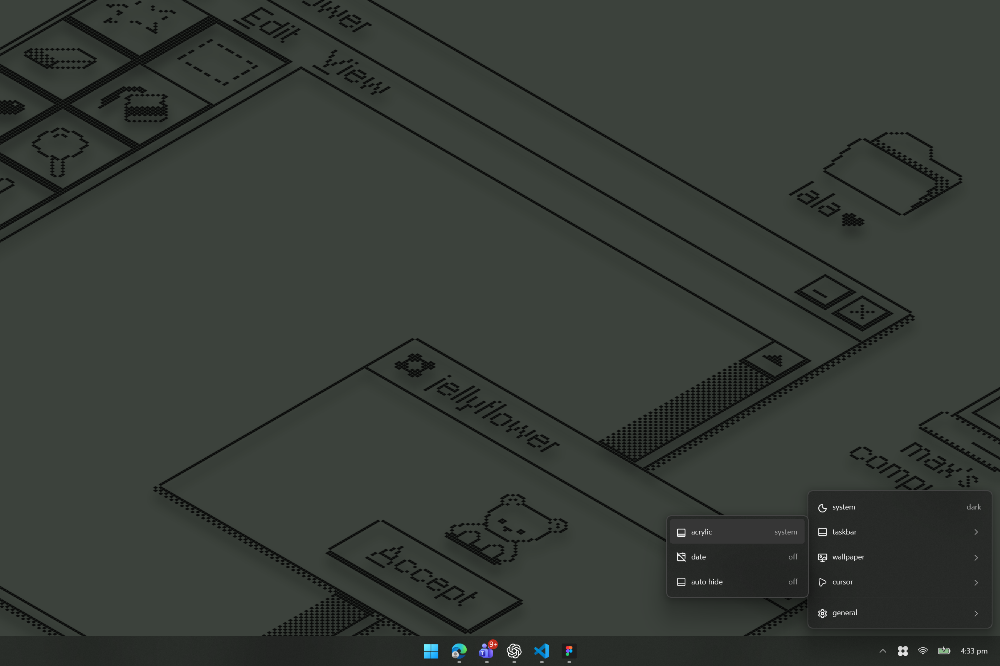
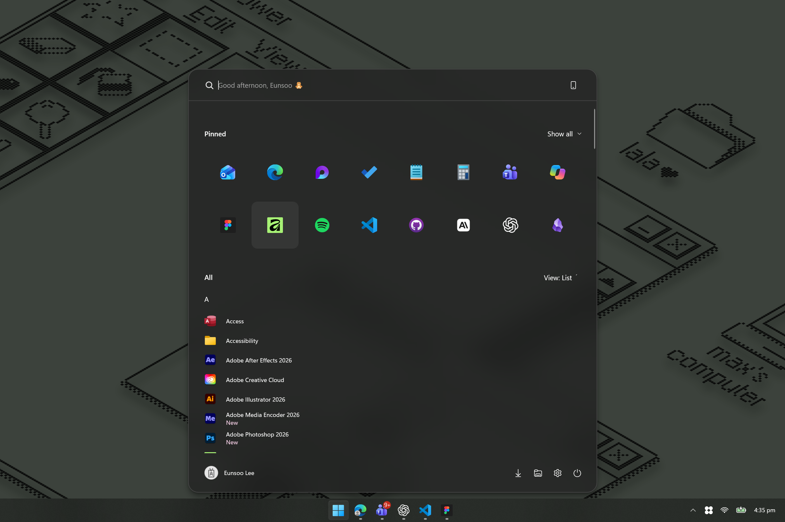

<p align="center">
  <picture>
    <source media="(prefers-color-scheme: dark)" srcset="docs/images/app-dark.png">
    
  </picture>
</p>

<h1 align="center">jellyflower</h1>





A small Windows 11 app for a frosted taskbar, a cleaner Start menu, and a desktop that follows your light and dark theme. Everything lives in the little flower in your system tray.

## Features

- Acrylic taskbar with three modes: system tint, pure blur, or off.
- Matching translucent Start and Search styling, with an icon-only pinned grid and a personal greeting.
- A single-line clock with an optional date, keeping the Windows calendar click and tooltip.
- Light, dark, or automatic system themes that switch at sunrise and sunset.
- Included light and dark jellyflower wallpapers that follow your system theme or their own sunrise/sunset schedule.
- Optional cursor colors with hover previews, using your own separately licensed cursor pack.
- Windows auto hide, controlled right from the taskbar menu.
- Automatic launch at login and updates you can download and install inside the app.

## Download and install

[Download jellyflower for Windows x64](https://github.com/mochimilk/jellyflower/releases/latest/download/jellyflower-setup-x64.exe) · [All releases](https://github.com/mochimilk/jellyflower/releases)

Double-click the installer. It installs for your Windows account, starts jellyflower, and enables launch at login. No administrator rights, terminal commands, or extra runtime download is needed. Close TranslucentTB before using jellyflower.

The installer is currently unsigned. Windows 11's standard taskbar is the main target; some shell styling depends on your Windows version. Jellyflower stays running in battery saver, although Windows may reduce or disable the visible blur.

## Make it yours

Click the flower under **show hidden icons** to open the menu. Click it again or click outside to close it. Settings keep the menu open while you try them.

| Menu | What you can change |
| --- | --- |
| system | Light, dark, or auto. Auto uses location with your permission to calculate sunrise and sunset locally. |
| taskbar | Acrylic mode, date, and Windows auto hide. |
| wallpaper | Turn the jellyflower wallpapers on or off, and follow the system theme or sunrise/sunset. |
| colors / cursor | Import your cursor pack, then preview and choose a color. |
| general | Visit GitHub, check your installed version for updates, or exit. |

Cursor artwork is **not bundled**. Choose **colors > unlock** for instructions, get your own full Cursor Concept 3 HDPi ZIP from [JepriCreations](https://jepricreations.com/products/cursor-concept-3-hdpi), and drop it into the folder jellyflower opens. Until you import a pack, your Windows cursor stays as it is.

In **general**, select the version number to check for updates. If it says **download**, select it again to install and relaunch. Your preferences and cursor pack stay in place.

Choose **general > exit** to close jellyflower and restore its taskbar, clock, Start styling, and cursor changes. Your chosen Windows theme and auto-hide preference stay selected; turn the jellyflower wallpaper off first if you want your previous wallpaper back. Uninstall through **Windows Settings > Apps > Installed apps**.

## More details

- [Full guide](docs/GUIDE.md): menu behavior, cursor import, wallpaper, startup, and compatibility.
- [Start menu styling](docs/START_MENU.md): supported layouts and limitations.
- [Pure acrylic contrast](docs/ADAPTIVE_CONTRAST.md): supported monochrome icons and auto hide.
- [Battery saver](docs/INVESTIGATION.md): what the app controls and what Windows controls.
- [Updates](docs/UPDATES.md): in-app updates and release details.

## Build from source

Install Visual Studio 2022 Build Tools with Desktop development with C++, C++ CMake tools, and Windows SDK 10.0.20348 or newer. Use CMake 3.24+. Then run:

```powershell
.\Build.ps1
```

Double-click `dist\x64\jellyflower-setup-x64.exe` to install. To build ARM64, install its C++ tools and run `Build.ps1 -Architecture ARM64`. Checked-in ICO files and native cursor geometry mean Python and SVG libraries are optional, only needed for regenerating artwork. The C++ runtime is linked statically; Windows supplies the remaining libraries.

To run a portable build, keep `jellyflower.exe`, `jellyflower-bridge-v17.dll`, `jellyflower-start-v19.dll`, both app ICOs, and license/notices together. `Install.ps1` in the distribution enables startup from that exact directory. `Diagnose.ps1` writes the controller's JSON status. Maintenance commands include `--stop`, `--install`, `--uninstall`, `--diagnose <file>`, `--verify-cursors <folder>`, and `--restore-cursors`. A five-second taskbar recovery timer complements system and shell events; automatic theme scheduling uses its separate event timer. Other shell liveness/clock timers still run, so this change alone is not a measured battery-life improvement. Logs are bounded to roughly 64 KiB in `%LOCALAPPDATA%\jellyflower\diagnostics.log`.

The GitHub workflow builds x64 and ARM64 and publishes tagged releases. `Publish.ps1` publishes the first local x64 build using the maintainer's normal GitHub CLI login. [UPDATES.md](docs/UPDATES.md) documents the release process.

## License

GPL-3.0-or-later. See [LICENSE.md](LICENSE.md) and [THIRD_PARTY_NOTICES.md](THIRD_PARTY_NOTICES.md). This is an independent project using simplified techniques adapted from TranslucentTB. Corresponding source is provided with each release. External cursor licenses remain with their respective authors.
